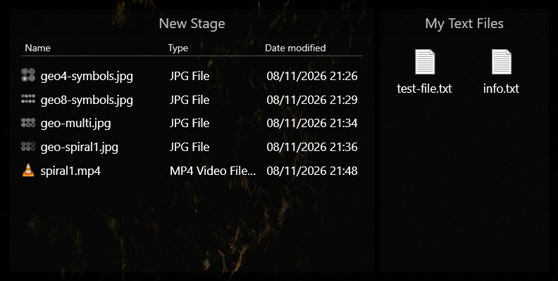

# Stages
An open source and free alternative to Stardock Fences with comparable functionality.

**Clean up your desktop with Stages for Windows.** 

- A Stage holds shortcuts to your files and folders.  It can also show a live folder, the windows you have open, or your clipboard history. Stages is free and open source, for Windows 10 and 11.
- Stages began as a VB.NET/WPF rewrite of [NoFences](https://github.com/Twometer/NoFences) by Twometer. This application fixes some bugs that NoFences had and expands upon the idea with additional useful features.

## Highlights

- **Four kinds of Stage**: shortcuts you drop on it, a **live folder** (Downloads, a project, a drive), **running tasks** (your open windows) and **clipboard history** (text, pictures and files you copied).
- **Tabs**: one Stage can hold several tabs, each of any kind.
- **Never touches your files.** Dropping something on a Stage makes a shortcut. Removing it sends only the shortcut to the Recycle Bin.
- **Explorer's own right-click menu** on every item, real icons with no shortcut arrows, and changeable icons.
- **Views like Explorer**: large, medium or small icons, list or details, sorted or arranged by hand.
- **Looks**: blur, imitation acrylic or translucent backgrounds, a background picture per Stage, light and dark themes, and your own colours, fonts and corners.
- **Lines up neatly**: snaps beside other Stages with an even gap and shows guide lines. It can also snap to every Stage and the screen edges, or not at all. Hold Alt to place a Stage freely.
- **Rolls up to its title bar**: when the mouse leaves (Minify), or with a click on the title bar.
- **Survives Explorer restarts**, monitor changes and damaged settings files, and keeps a backup of every save.
- **Hide or show every Stage** with one keyboard shortcut, and save or restore everything as one .zip backup.

*Pretty much all appearance/usability settings are customisable per-stage or globally*

There's the full list of features **[here](FEATURES.md)**, and how everything works is **[here](USER-GUIDE.md)**.

## Requirements

- Tested on Windows 10 or Windows 11, including all other standard/LTSC versions.
- .NET Framework 4.8. It's built into Windows 11 and Windows 10 1903 or later. Windows 10 LTSC 2019 / IoT LTSC 2019 come with 4.7.2 and need [.NET Framework 4.8](https://dotnet.microsoft.com/download/dotnet-framework/net48) installed.
- For blur and acrylic, Windows' **Transparency effects** must be on (Windows Settings → Personalization → Colors). With them off, Stages look solid.

- *Stages may work on Windows Vista/7/8 providing .Net Framework 4.8 is installed but this has not yet been tested.*

## Installing

1. Download `Stages-Setup-<version>.exe` from the [Releases](https://github.com/x87e/stages/releases) page.
2. Run it. It installs for your Windows account only and doesn't ask for administrator rights.
3. Use the Install option in Settings for proper installation which melts the executable to %localappdata%, adds persistence and a Start menu entry.

Stages installs into `%LOCALAPPDATA%\Programs\Stages\App`. Your Stages and settings live beside it in that `Stages` folder and are left alone by upgrades. When you uninstall, you're asked whether to remove them too (the default is No); if you say Yes, they go to the Recycle Bin rather than being deleted for good.

Windows may show **"Windows protected your PC"**, because the installer isn't code-signed. Choose **More info → Run anyway**.

Only one copy of Stages runs at a time. To quit, right-click the Stages icon in the System Tray and choose **Quit Stages**.

## Getting started

1. Right-click the Stages icon in the notification area → **New Stage**.
2. Drag files, folders or shortcuts onto the Stage.
3. Drag the title bar to move it, and drag an edge or corner to resize it.
4. Right-click a Stage for its menu: views, sorting, tabs, background, lock, minify and more.
5. Double-click the tray icon for **Settings**.

- *Items saved to the desktop should be moved to another folder and added from there unless you choose to hide desktop icons yourself or from Stages. If you don't do it like this, you will have a Stages shortcut but still have an icon on the desktop, defeating the purpose of the program!*

## Building from source

Stages has no additional dependencies: everything it uses is part of .NET Framework 4.8.

1. Install Visual Studio 2019 or 2022 with the **.NET desktop development** workload.
2. Open `Stages.sln` and build (**Build → Build Solution**, Ctrl+Shift+B).
3. The program is in `Stages\bin\Release\` (or `bin\Debug\`). `Stages.exe` can run from anywhere; it always keeps its Stages and settings in `%LOCALAPPDATA%\Programs\Stages`.

The code is commented throughout, aimed at readers who program but may not know VB.NET. The [user guide](USER-GUIDE.md#project-layout) has a map of the project.

## Status

Stages is at version **0.8.9**. It's still before 1.0, so expect the odd rough edge. Bug reports and suggestions are welcome in [Issues](https://github.com/x87e/stages/issues). Please include your Windows version and if something went wrong, the end of `%LOCALAPPDATA%\Programs\Stages\Logs\stages.log`.

## Credits and licence

Stages is based on [NoFences](https://github.com/Twometer/NoFences) by Twometer, which is released under the MIT licence. Stages is released under the MIT licence too; see [LICENSE](LICENSE), which keeps NoFences' original copyright notice.
